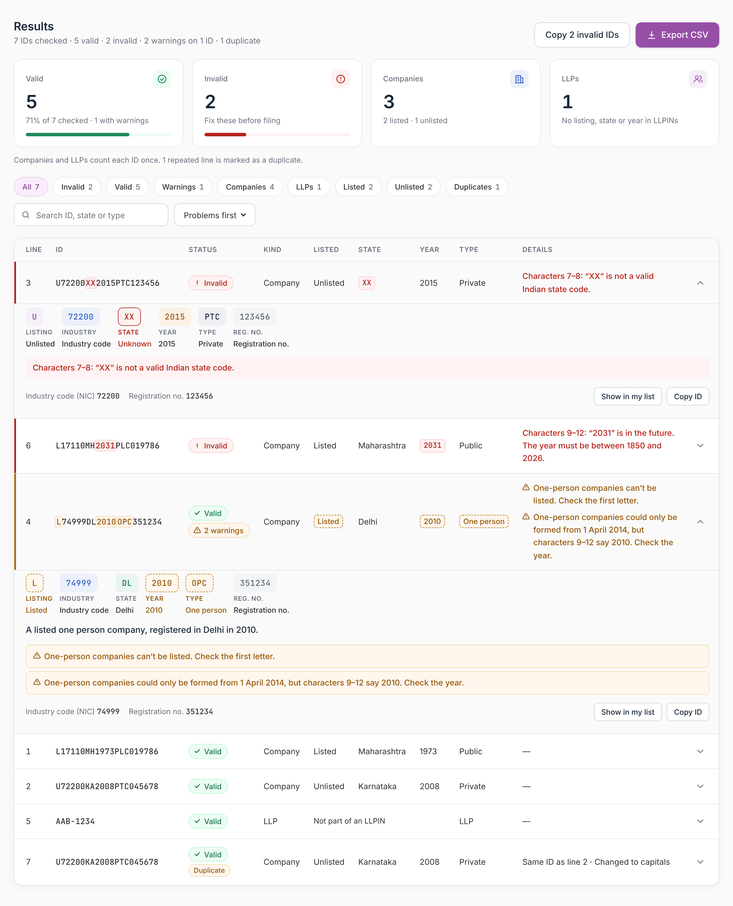
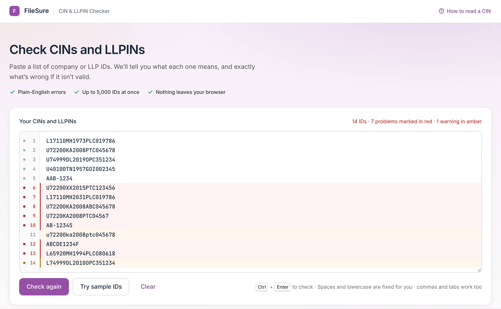
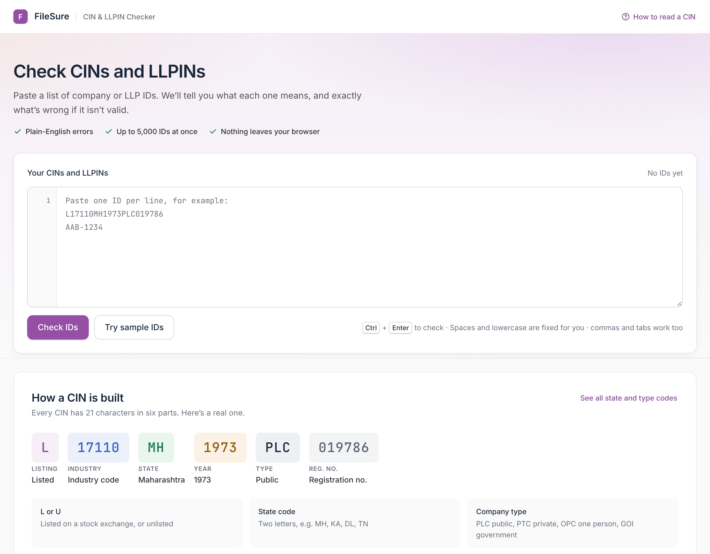
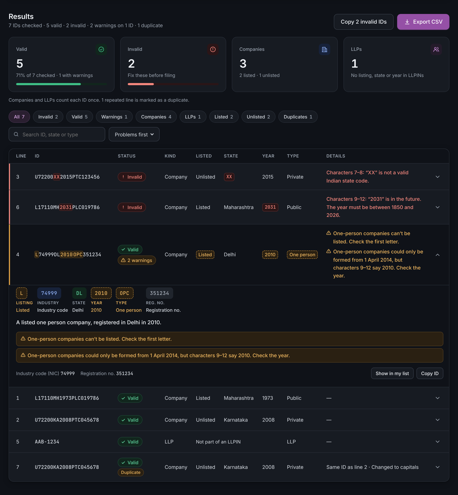
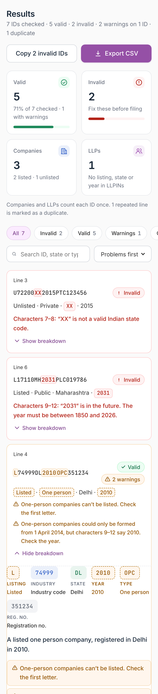

# CIN & LLPIN Checker

**Live demo: [arnav2293-afk.github.io/cin-llpin-checker](https://arnav2293-afk.github.io/cin-llpin-checker/)**

A web page where you paste a list of CINs and LLPINs (one per line) and see, for each one:

- whether it is valid, and if not, **exactly what is wrong** in plain English
  (e.g. *Characters 7–8: “XX” is not a valid Indian state code.*)
- company or LLP, listed or unlisted, state, year of incorporation and company type
- an amber **warning** when the format is valid but the combination breaks company law
  (e.g. a listed one-person company)

Built for the FileSure Tech Support & Operations internship assignment.



*Results for a mixed list. The invalid row (red) and the warning row (amber) are opened to show the
part-by-part breakdown.*

## Screenshots

All screenshots are from the [live site](https://arnav2293-afk.github.io/cin-llpin-checker/).

**Problems are marked in your own list.** Bad lines get a red dot and tint, warnings get amber,
and the counter above the box sums them up.



**First visit.** Before anything is pasted, the page explains how a CIN is built, using a real one.



**Dark mode and phone.** The page follows the system light or dark setting. Below 1,200px wide,
each table row becomes a card.

<table>
  <tr>
    <td width="68%"></td>
    <td width="32%"></td>
  </tr>
  <tr>
    <td align="center"><sub>Dark mode, 1280px</sub></td>
    <td align="center"><sub>Phone, 390px</sub></td>
  </tr>
</table>

## Run it

No build step and no dependencies. Open `index.html` in a browser, or serve the folder:

```bash
python3 -m http.server 8000
```

Then open <http://localhost:8000>.

Run the validator tests (Node 18+):

```bash
node --test test/validator.test.js
```

## Design

I explored four directions in Figma (Clean Utility, Split View, Segment Decoder,
Dashboard) and combined the two strongest:

- **Dashboard layout** for scanning big batches: summary tiles (Valid, Invalid,
  Companies, LLPs) that also act as filters, filter chips, search, sort, and a table
  that puts problems first. On an invalid row, the wrong field is highlighted in red;
  on a warning row, the fields concerned are highlighted in amber.
- **Segment decoder** for understanding a single ID: click any row to see it split
  into coloured, labelled parts, with the wrong part in red.

Colours come from filesure.in's own CSS variables: lavender `#A860B9` for the brand,
navy `#192839` for text, and their success, error and warning colours. Red is used
only for errors. The page uses Inter for text and JetBrains Mono for IDs, so characters line up.

### What the page shows when the input is…

| Input | What happens |
|---|---|
| Empty | A “How a CIN is built” explainer with an annotated example, and a **Try sample IDs** button. Pressing Check says “Paste at least one CIN or LLPIN first.” |
| Wrong | Every bad ID gets a specific message naming the characters at fault, plus hints for common slips (letter O instead of zero, `OD` instead of `OR`, a PAN or GSTIN pasted by mistake). |
| 500+ lines | Summary tiles first, problems sorted to the top, a header that stays pinned while you scroll, 100 rows at a time with “Show more”, “Copy invalid IDs” and CSV export. Up to 5,000 IDs per check. Footer link: **Try a 500-ID test list**. |

It also removes spaces, fixes lowercase, strips pasted labels like `CIN:`, accepts commas and
tabs (for pasting an Excel row), skips blank lines while keeping line numbers, and flags duplicates.
Obvious typos (the letter O instead of a zero, `OD` instead of `OR`) get a one-click fix.

The CSV export is in pasted order and safe to open in Excel: cells that Excel would run as a
formula (starting with `=`, `+`, `-` or `@`) or strip leading zeros from are kept as text.

Below 1,200px wide (tablets and phones) table rows become cards with a one-line summary.
The page follows the system light or dark setting, and all text meets WCAG AA contrast in both.

## Rules checked

**CIN** (21 characters, e.g. `L17110MH1973PLC019786`)

| Characters | Part | Rule |
|---|---|---|
| 1 | Listing | `L` (listed) or `U` (unlisted) |
| 2–6 | Industry | 5 digits (NIC code) |
| 7–8 | State | A known state or UT code (MH, KA, DL, TN, TG, UR, OR …) |
| 9–12 | Year | 4 digits, from 1850 to the current year |
| 13–15 | Type | PLC, PTC, OPC, GOI, SGC, FLC, FTC, GAP, GAT, NPL, ULL, ULT |
| 16–21 | Reg. no. | 6 digits |

**Warnings** (amber, the ID stays *valid*): the format is fine, but the combination breaks company law.

| Warning | Why |
|---|---|
| Listed (`L`) with a private type (OPC, PTC, GAP, ULT) | A private company can’t invite the public to buy its securities (Companies Act 2013, s.2(68)), so it can’t be listed. An OPC is a private company (s.3(1)(c)). |
| OPC with a year before 2014 | OPCs could only be formed once s.3 of the Companies Act 2013 came into force on 1 April 2014 (MCA notification S.O. 902(E), 26 March 2014). |

Each result has separate `errors` and `warnings` arrays. Warnings show with an icon and text,
are counted in the summary bar, have their own filter, and get their own CSV column.

**LLPIN**: 3 letters, a hyphen, 4 digits (e.g. `AAB-1234`). It has no state or year.
`AAB1234` is accepted and given its hyphen.

This checks the **format** only. It doesn’t look the company up in MCA records.

## Files

| File | What it does |
|---|---|
| `index.html` | Page structure |
| `styles.css` | Design tokens, layout, phone view |
| `validator.js` | Validation rules. Pure functions, no DOM, also loads in Node |
| `app.js` | Input handling, tiles, filters, table, breakdown, CSV export |
| `test/validator.test.js` | 32 unit tests for the validator, including both warning rules and a 14-line QA list |
| `docs/screenshots/` | Screenshots of the live site used in this README |
